<p align="center">
  
</p>

<h1 align="center">OTP Bridge</h1>

<p align="center">
  Text-message login codes, autofilled on your Windows PC.<br>
  Free, open source, and no cloud account needed.
</p>

<p align="center">
  <a href="https://github.com/Jose0213/otp-bridge/releases/latest"></a>
  <a href="https://github.com/Jose0213/otp-bridge/releases"></a>
  <a href="LICENSE"></a>
  
  
</p>

---

A Mac fills in text-message codes from an iPhone automatically. Windows has nothing similar. OTP Bridge fills that gap.

When a text with a code arrives, your phone forwards it to your PC. OTP Bridge pulls out the code, copies it to the clipboard, and shows a notification. Press **Ctrl+Alt+O** to type it into whatever field you're in.

<p align="center">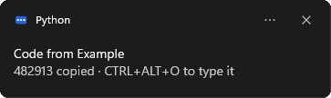</p>

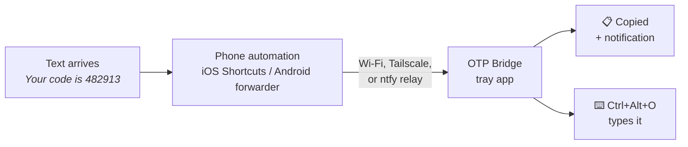

## Features

- **iPhone and Android.** Uses a Shortcuts automation on iPhone, or any SMS-to-webhook app on Android.
- **Smart detection.** Finds the code even when the message also contains phone numbers, dollar amounts, dates, or times. Handles `G-123456`, `123-456`, `123 456`, and letter-and-number codes.
- **Fills web forms.** With the Edge or Chrome extension, click into a login page's code field and the code goes straight in, the way Safari offers it on a Mac.
- **Types it for you.** The hotkey types the code into whatever field has focus, in a browser or a desktop app, not only web forms.
- **Private by default.** Codes stay in memory, expire after 5 minutes, and never touch the disk or the log. Your previous clipboard text is put back when a code expires.
- **Works from anywhere.** Choose your home network, Tailscale, or an ntfy relay. No port forwarding needed.
- **Lightweight.** A tray icon with no console window. It starts when you sign in.

## Install

### Download the .exe (no Python needed)

1. Download `OtpBridge.exe` from the [latest release](https://github.com/Jose0213/otp-bridge/releases/latest) and put it somewhere permanent, such as `%LOCALAPPDATA%\Programs\OTP Bridge\`.
2. Double-click it. Look for the blue icon in the tray.
3. To start it when you sign in, open a terminal in that folder and run:

   ```powershell
   .\OtpBridge.exe install-startup
   ```

Every command below works the same way: use `.\OtpBridge.exe` in place of `otp-bridge`. Windows SmartScreen may warn the first time because the exe isn't code-signed; choose **More info**, then **Run anyway**.

### Install with Python

You need Python 3.9 or newer.

```bash
pipx install git+https://github.com/Jose0213/otp-bridge
otp-bridge install-startup
otp-bridge
```

The second command makes OTP Bridge start when you sign in. The third starts it now.

The first time OTP Bridge runs, Windows Firewall may ask whether to allow it on networks. Allow it on **private** networks. Relay mode doesn't need this.

## Quick start

1. **Install** OTP Bridge (above) and make sure the tray icon is showing.
2. **Choose a connection mode** (below). If your phone and PC share Wi-Fi, the default direct mode needs no setup.
3. **Get your setup values.** Right-click the tray icon, choose **Phone setup…**, and click any value to copy it.

   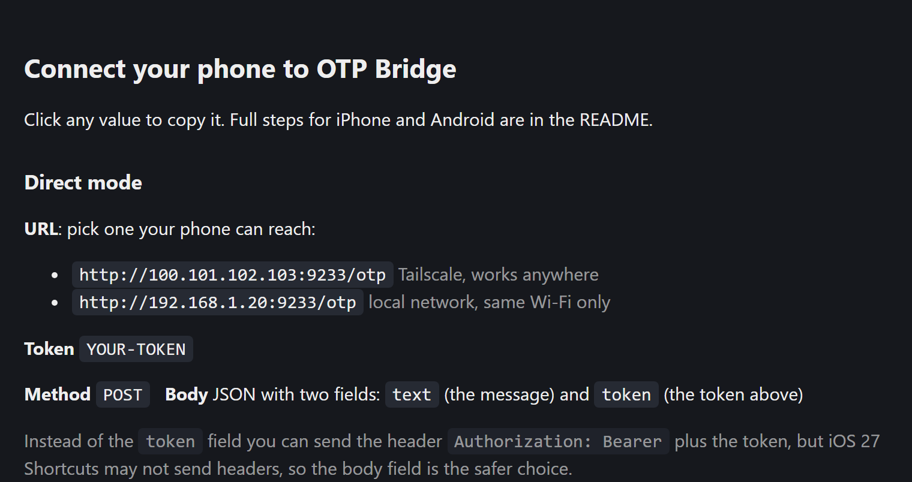

4. **Set up your phone** using the [iPhone](#iphone-ios-27) or [Android](#android) steps.
5. **Test it.** Text yourself `Your test code is 123456` from another phone, or use a site's "send code" button. The code should appear in a notification within a couple of seconds.

## Connection modes

| Mode | Works when | Extra setup | Privacy |
|---|---|---|---|
| **Direct, home network** (default) | Phone and PC are on the same Wi-Fi | None | Messages stay on your network |
| **Direct, Tailscale** | Anywhere | Install [Tailscale](https://tailscale.com) on both devices | End-to-end encrypted, between your own devices |
| **Relay** | Anywhere | `otp-bridge setup --relay` | Messages pass through an [ntfy](https://ntfy.sh) server |

**Direct mode** rejects any request that lacks your token or comes from outside a private or Tailscale address.

**Relay mode** is the easiest way to make it work everywhere: the PC only connects outward, so firewalls and VPNs don't matter. The tradeoff is that anyone who learns your random topic URL can read what's posted to it. To keep everything on hardware you control, [self-host ntfy](https://docs.ntfy.sh/install/):

```bash
otp-bridge setup --relay --relay-server https://ntfy.example.com
```

Run `otp-bridge setup --direct-only` to turn relay mode off again.

## Phone setup

### iPhone (iOS 27)

On iOS 27 an automation is a shortcut with a trigger at the top: one shortcut runs when a text arrives and sends it to your PC. Add the ready-made one (about two minutes) or build it yourself (about five). Either way you need the address and token from **Phone setup** on your PC.

> **Keep Shortcuts notifications on.** iOS shows a short notification whenever a message automation runs. If you turn Shortcuts notifications off in Settings, iOS stops running the automation at all, and no codes arrive. See [Troubleshooting](#troubleshooting) for ways to make the notification less intrusive.

#### Quick setup: add the ready-made shortcut

1. On your iPhone, open **[the OTP Bridge shortcut](https://www.icloud.com/shortcuts/c93ddc7f9b734604bca2e39b698d49e1)** and tap **Add Shortcut**. If the sheet doesn't close, tap **Skip Setup**; this is a known iOS 27 bug. It's added under the name **Get Contents of URL**, which you can rename.
2. Open it. In the **first** Text action, delete `YOUR-PC-ADDRESS` (including the empty line after it) and paste the URL from **Phone setup** on your PC, for example `http://192.168.1.20:9233/otp`.
3. In the **second** Text action, replace `YOUR-TOKEN` with your token, without `Bearer`.
4. Tap the arrow next to **where** in the trigger at the top. Turn **Automation** on (shared shortcuts arrive with it off) and make sure **Confirm Before Run** is off.
5. Tap **▶**. `{"code": null}` means it reached your PC and the token works. Then text yourself `Your test code is 123456`.

Everything else, including the message trigger and the request, is already set up. To build it yourself instead, or to see what each part does, open the steps below.

<details>
<summary><b>Build it yourself</b> (8 steps with screenshots)</summary>

<table>
<tr>
<td width="50%" valign="top">

**1. Create the trigger.** Make a new shortcut and add the **Message** trigger. Set **Message contains** to `code`.

</td>
<td>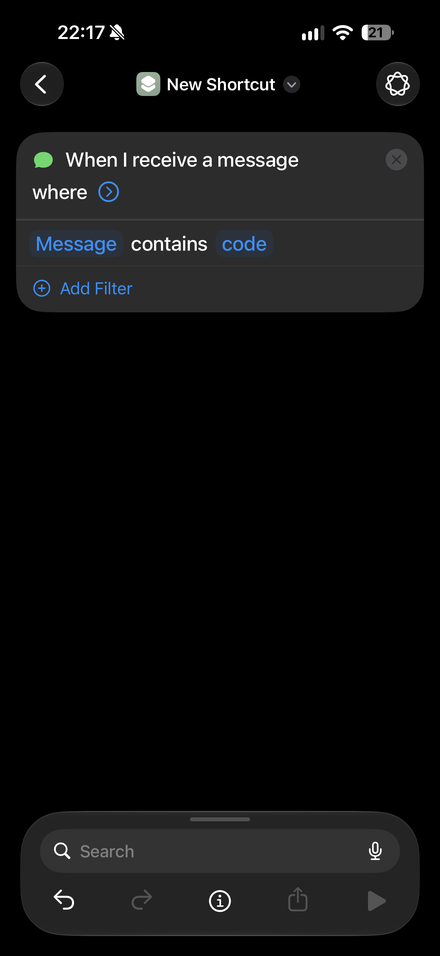</td>
</tr>
<tr>
<td valign="top">

**2. Add your PC's address.** Search for **Text**, add it, and type the URL from Phone setup, for example `http://192.168.1.20:9233/otp`. It must start with `http://`.

</td>
<td>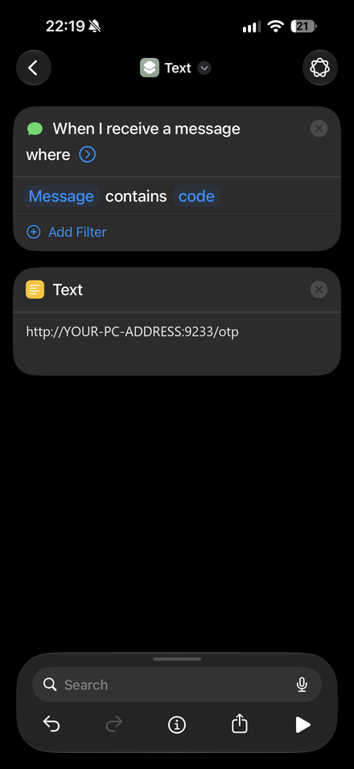</td>
</tr>
<tr>
<td valign="top">

**3. Add your token.** Add a second **Text** action containing only the token, without `Bearer`.

</td>
<td>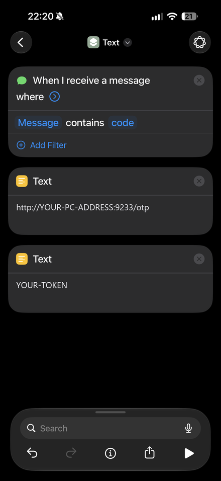</td>
</tr>
<tr>
<td valign="top">

**4. Add the request.** Search for **Get Contents of URL** and add it. Tap its URL, choose **Select Variable**, and tap the **first** Text action, the address. Both actions are called "Text", so make sure you tap the right one.

</td>
<td>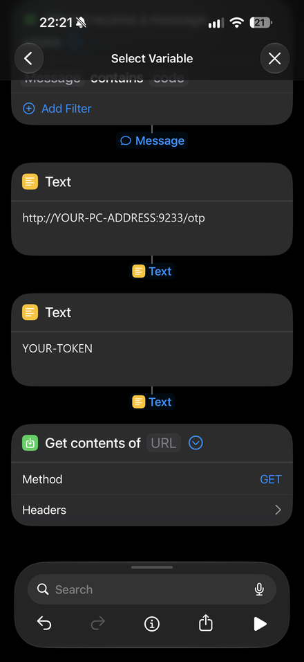<br>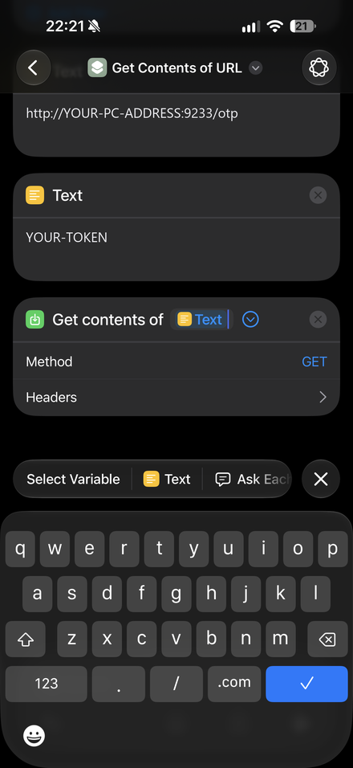</td>
</tr>
<tr>
<td valign="top">

**5. Set the method.** Change **GET** to **POST**. You can also add the header `Authorization` = `Bearer` + the token, but iOS 27 may not send it, so step 6 puts the token in the body as well.

</td>
<td>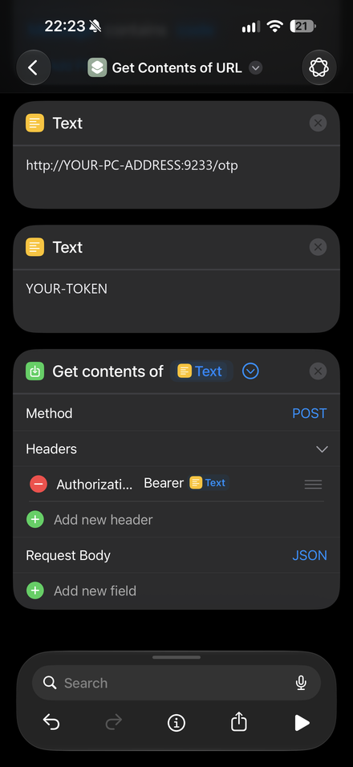</td>
</tr>
<tr>
<td valign="top">

**6. Fill in the body.** Under **Request Body** (JSON), add two Text fields:

- `text`: choose **Select Variable**, tap the blue **Message** under the trigger, then tap it again and choose **Content**
- `token`: choose **Select Variable** and tap the **second** Text action, the token

Key names can be in any letter case.

</td>
<td>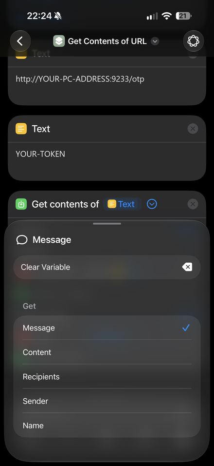<br>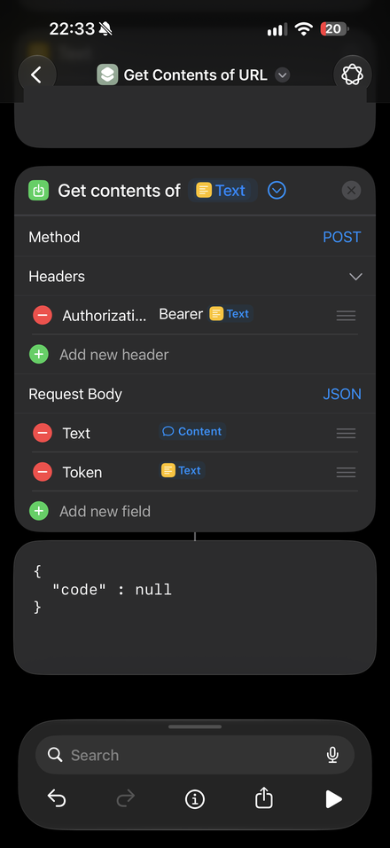</td>
</tr>
<tr>
<td valign="top">

**7. Check that the trigger is on.** Tap the arrow next to **where** in the trigger to show its settings. **Automation** must be on and **Confirm Before Run** off.

</td>
<td>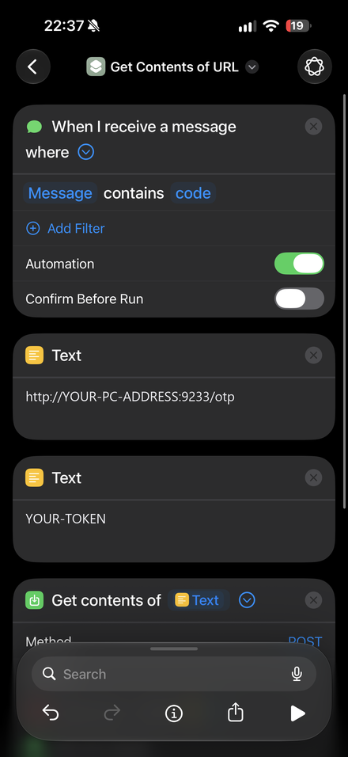</td>
</tr>
<tr>
<td valign="top">

**8. Test it.** Tapping **▶** should return `{"code": null}`: your phone reached the PC and the token worked, and it's `null` because a manual run has no message in it. `unauthorized` means the token is wrong. Then text yourself `Your test code is 123456`; the code should appear on your PC within a couple of seconds.

</td>
<td></td>
</tr>
</table>

</details>

To also catch texts like "Your OTP is…", add a second **Message** trigger with `OTP`. Duplicate forwards of the same code are ignored. If you use Tailscale, turn on **VPN On Demand** in the Tailscale app so the phone stays connected.

<details>
<summary><b>iPhone on iOS 17 to 26</b></summary>

1. Open **Shortcuts**, go to the **Automation** tab, tap **+**, and choose **Message**. It's in the list of triggers, not in the actions search.
2. Under **Message Contains**, enter `code`. This also matches "passcode". Leave **Sender** as anyone.
3. Choose **Run Immediately** (on newer iOS, turn **Confirm Before Run** off). Tap **Next**, then **New Blank Automation**. iOS will show a short notification each time it runs; see [Troubleshooting](#troubleshooting) for ways to quiet it.
4. Tap **Add Action**, search for **Get Contents of URL**, and tap it. If the search bar shows a **Messages** filter chip, clear it first.
5. Paste the URL from Phone setup. It must start with `http://`, not `https://`.
6. Show the action's options and set:
   - **Method**: `POST`
   - **Headers**: add `Authorization` with the value `Bearer`, a space, and your token, for example `Bearer 28UKJHxxxx`. No brackets. (Direct mode only.)
   - **Request Body**: `JSON`, with these Text fields:
     - `text`: set the value to the **Message** variable
     - `token`: your token (needed if iOS drops the header; harmless otherwise)
     - `sender`: set the value to the **Message** variable, then tap it and choose **Sender** (optional)

   Key names can be in any letter case.
7. Tap **▶** to test. A response of `{"code": null}` means your phone reached the PC; it's `null` only because a manual run has no message in it. `unauthorized` means the token or header is wrong.

</details>

### Android

Use any app that forwards incoming SMS to a URL, such as the open-source [Incoming SMS to URL forwarder](https://github.com/bogkonstantin/android_income_sms_gateway_webhook). Configure it to:

- send to the URL from Phone setup
- add the header `Authorization` with the value `Bearer` followed by a space and your token (direct mode only)
- send a JSON body that includes the message as `text` (the `from` field is read as the sender), or the raw message as plain text

If the app supports filters, forward only messages that contain "code", so the rest of your texts never leave the phone.

## Browser extension (Edge and Chrome)

The extension fills one-time-code fields for you, so you don't need the hotkey on websites. Click into the code field, and the code appears there as soon as it arrives (or right away if it arrived in the last 90 seconds).

**Install (unpacked, until it's in the stores):**

1. Download **OtpBridge-extension.zip** from the [latest release](https://github.com/Jose0213/otp-bridge/releases/latest) and unzip it somewhere permanent (the browser loads it from that folder).
2. Open `edge://extensions` (or `chrome://extensions`), turn on **Developer mode**, click **Load unpacked**, and choose the unzipped `OtpBridge-extension` folder. From a clone of this repository, choose the `extension` folder instead.
3. The options page opens. Right-click the OTP Bridge tray icon, choose **Copy browser pairing key** (or run `otp-bridge pair-extension`), paste the key, and click **Save**. It should say **Connected**.

**What it fills:** fields marked `autocomplete="one-time-code"`, rows of 4 to 8 one-character boxes, and fields whose name, label, or placeholder says things like "verification code", "OTP", or "2FA". Promo, coupon, ZIP, and phone fields are left alone. Each field is filled once, and a small "Code filled" label confirms it. If you've started typing in the field, it isn't touched.

**How it stays private:**

- The extension only fills a code field you've clicked or tabbed into, on the tab you're looking at. A page or an embedded frame (such as an ad) can't receive a code just by showing a code box, and nothing is filled in a background tab.
- A code counts if it arrived after the field appeared, or up to 90 seconds before. Older codes aren't filled, and a code is filled only once, so it won't land in a second form.
- OTP Bridge answers the extension only on `127.0.0.1`. To the LAN and Tailscale, the endpoint doesn't exist. Web pages can't use it either: the pairing key is required, and requests from a web page's origin or a rebinding hostname are refused.
- Codes stay in memory in the app and the browser. The extension remembers only a hash of the last filled code, in session memory.

The extension needs two permissions: access to `127.0.0.1` to talk to OTP Bridge, and access to the sites you visit, to find code fields. It sends nothing anywhere else. Like any autofill, it fills the code into whatever site you click into, so check the site before you submit.

## Commands

| Command | What it does |
|---|---|
| `otp-bridge` | Start the tray app |
| `otp-bridge setup` | Print the URL and token for your phone |
| `otp-bridge setup --relay` | Turn on relay mode with a new random topic |
| `otp-bridge pair-extension` | Print the key that pairs the browser extension |
| `otp-bridge test "<message>"` | Show which code would be pulled out of a message |
| `otp-bridge install-startup` | Start OTP Bridge when you sign in |
| `otp-bridge uninstall-startup` | Stop starting it at sign-in |

## Settings

Settings are stored in `%APPDATA%\otp-bridge\config.json`. Open that folder from the tray menu. Restart OTP Bridge after editing.

| Key | Default | Meaning |
|---|---|---|
| `port` | `9233` | Port for direct mode |
| `hotkey` | `ctrl+alt+o` | Types the latest code. Modifiers: `ctrl`, `alt`, `shift`, `win`. Keys: a letter, digit, or `f1` to `f24`. |
| `ttl_seconds` | `300` | How long a code stays usable |
| `restore_clipboard` | `true` | Put your previous clipboard text back when a code expires |
| `allow_public_ips` | `false` | Accept direct requests from non-private addresses (not recommended) |
| `relay_url` | `""` | ntfy topic URL; empty means direct only |
| `token` | random | Shared secret for direct mode. Delete it to generate a new one. |
| `extension_key` | random | Pairs the browser extension. Delete it to generate a new one, then pair again. |

## Troubleshooting

<details>
<summary><b>The phone runs the automation, but nothing shows up on the PC</b></summary>

- Make sure the tray icon is showing. If it isn't, start OTP Bridge.
- Same Wi-Fi: check that the phone isn't on mobile data, and that the URL is your PC's local address, not the Tailscale one.
- Tailscale: check that Tailscale is connected on both devices.
- Open `http://<your-pc-address>:9233/health` in the phone's browser. If it doesn't load, Windows Firewall is blocking the connection; allow OTP Bridge (or Python) on private networks.
- Check that Shortcuts notifications are allowed on the phone. Message automations don't run without them.
- Read `%APPDATA%\otp-bridge\otp-bridge.log`. A `bad token` line means the token didn't match `config.json`; it lists which headers arrived, so `auth scheme=none` means the phone sent no Authorization header (put the token in the body instead).

</details>

<details>
<summary><b>The notification shows the wrong code, or none</b></summary>

Run `otp-bridge test "<the message>"` to see what's detected. If it's wrong, please [report it](https://github.com/Jose0213/otp-bridge/issues/new?template=missed_code.yml) with the personal details replaced. That's how detection gets better.

</details>

<details>
<summary><b>Ctrl+Alt+O does nothing</b></summary>

Another app may already use that shortcut. The tray menu shows "(unavailable)" next to the hotkey when it couldn't be registered. Change `hotkey` in `config.json` (for example to `ctrl+shift+f9`) and restart OTP Bridge. Typing into windows that run as administrator also requires running OTP Bridge as administrator.

</details>

<details>
<summary><b>The iPhone shows a "Running your automation" notification every time</b></summary>

iOS always shows a notification when a **Message** automation runs. Apple requires it for message, email, Wi-Fi, Bluetooth, and location triggers, so there's no switch to turn it off for a single automation.

**Don't turn Shortcuts notifications off.** If you disable them in Settings → Screen Time, iOS stops running message automations entirely, and no codes reach your PC. We confirmed this on iOS 27: codes stopped arriving when notifications were turned off and came back as soon as they were turned on.

Options that keep the automation running:

- **Bundle them:** Settings → Notifications → **Scheduled Summary** → add **Shortcuts**. The banners arrive in your summary instead of interrupting you. Notifications stay allowed, so automations should keep running, but this hasn't been tested yet. Send yourself a test code after turning it on. Prompts from automations set to **Confirm Before Run** may be held for the summary too.
- **Hide them in a Focus:** in a Focus you use (Settings → Focus), silence the Shortcuts app. Banners are hidden only while that Focus is on.

</details>

<details>
<summary><b>The iPhone automation asks before running</b></summary>

Edit the automation and choose **Run Immediately**. This needs iOS 17 or later.

</details>

## FAQ

**Does OTP Bridge read all my texts?**
No. On iPhone, only texts containing your chosen word (such as "code") are forwarded. On Android, set a filter in the forwarder app. OTP Bridge keeps only the extracted code, in memory, until it expires.

**Is my token a password?**
It's a shared secret between your phone and your PC. Anyone on your network who has it could send fake codes, but couldn't read your real ones. To change it, delete `token` from `config.json`, restart, and update your phone.

**Why not Microsoft Phone Link?**
Phone Link can show your texts, but it doesn't pull out the code or type it for you.

**macOS or Linux?**
Macs already have this built in for iPhones. Linux support would be welcome; see [CONTRIBUTING.md](CONTRIBUTING.md).

## API

To build your own sender, send `POST /otp` with the token as `Authorization: Bearer <token>`, an `X-OTP-Token` header, or a `token` field in the JSON body, and either JSON `{"text": "...", "sender": "..."}` or a plain-text body. The response is `{"code": "482913"}`, or `{"code": null}` when the message has no code. `GET /health` returns `{"ok": true}`.

`GET /latest` is for the browser extension and only answers on loopback (`127.0.0.1`). Send the pairing key as `X-OTP-Bridge-Key`. It returns `{"code": "482913", "id": 3, "age": 4.2}`, or `{"code": null, "id": 3}` when there's no unexpired code. Add `?after=<id>&wait=<seconds>` (up to 30) to wait for a code newer than `id`. A request with an `Origin` that isn't a browser extension, or a `Host` other than `127.0.0.1`, `localhost`, or `::1`, gets `403`.

## Contributing

Contributions are welcome, especially missed-code reports, macOS and Linux ports, and import questions for the shared iPhone shortcut, so people don't have to edit it by hand. See [CONTRIBUTING.md](CONTRIBUTING.md), and report security issues privately as described in [SECURITY.md](SECURITY.md).

## License

[MIT](LICENSE) © Jose Franco
