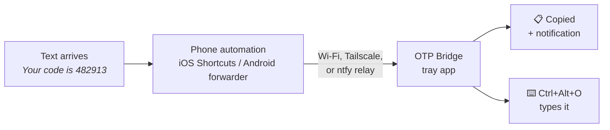

<p align="center">
  
</p>

<h1 align="center">OTP Bridge</h1>

<p align="center">
  Text-message login codes, autofilled on your Windows PC.<br>
  Free, open source, and no cloud account needed.
</p>

<p align="center">
  <a href="https://github.com/Jose0213/otp-bridge/actions/workflows/ci.yml"></a>
  <a href="https://github.com/Jose0213/otp-bridge/releases/latest"></a>
  <a href="LICENSE"></a>
  
  
</p>

---

A Mac fills in text-message codes from an iPhone automatically. Windows has nothing similar. OTP Bridge fills that gap.

When a text with a code arrives, your phone forwards it to your PC. OTP Bridge pulls out the code, copies it to the clipboard, and shows a notification. Press **Ctrl+Alt+O** to type it into whatever field you're in.



## Features

- **iPhone and Android.** Uses a Shortcuts automation on iPhone, or any SMS-to-webhook app on Android.
- **Smart detection.** Finds the code even when the message also contains phone numbers, dollar amounts, dates, or times. Handles `G-123456`, `123-456`, `123 456`, and letter-and-number codes.
- **Types anywhere.** The hotkey types the code into browsers, desktop apps, and remote desktop sessions, not only web forms.
- **Private by default.** Codes stay in memory, expire after 5 minutes, and never touch the disk or the log. Your previous clipboard text is put back when a code expires.
- **Works from anywhere.** Choose your home network, Tailscale, or an ntfy relay. No port forwarding needed.
- **Lightweight.** A tray icon with no console window. It starts when you sign in.

## Install

### Download the .exe (no Python needed)

1. Download `OtpBridge.exe` from the [latest release](https://github.com/Jose0213/otp-bridge/releases/latest) and put it somewhere permanent, such as `%LOCALAPPDATA%\Programs\OTP Bridge\`.
2. Double-click it. Look for the blue icon in the tray.
3. To start it when you sign in, open a terminal in that folder and run:

   ```powershell
   .\OtpBridge.exe install-startup
   ```

Every command below works the same way: use `.\OtpBridge.exe` in place of `otp-bridge`. Windows SmartScreen may warn the first time because the exe isn't code-signed; choose **More info**, then **Run anyway**.

### Install with Python

You need Python 3.9 or newer.

```bash
pipx install git+https://github.com/Jose0213/otp-bridge
otp-bridge install-startup
otp-bridge
```

The second command makes OTP Bridge start when you sign in. The third starts it now.

The first time OTP Bridge runs, Windows Firewall may ask whether to allow it on networks. Allow it on **private** networks. Relay mode doesn't need this.

## Quick start

1. **Install** OTP Bridge (above) and make sure the tray icon is showing.
2. **Choose a connection mode** (below). If your phone and PC share Wi-Fi, the default direct mode needs no setup.
3. **Get your setup values.** Right-click the tray icon, choose **Phone setup…**, and click any value to copy it.
4. **Set up your phone** using the [iPhone](#iphone-ios-17-or-later) or [Android](#android) steps.
5. **Test it.** Text yourself `Your test code is 123456` from another phone, or use a site's "send code" button. The code should appear in a notification within a couple of seconds.

## Connection modes

| Mode | Works when | Extra setup | Privacy |
|---|---|---|---|
| **Direct, home network** (default) | Phone and PC are on the same Wi-Fi | None | Messages stay on your network |
| **Direct, Tailscale** | Anywhere | Install [Tailscale](https://tailscale.com) on both devices | End-to-end encrypted, between your own devices |
| **Relay** | Anywhere | `otp-bridge setup --relay` | Messages pass through an [ntfy](https://ntfy.sh) server |

**Direct mode** rejects any request that lacks your token or comes from outside a private or Tailscale address.

**Relay mode** is the easiest way to make it work everywhere: the PC only connects outward, so firewalls and VPNs don't matter. The tradeoff is that anyone who learns your random topic URL can read what's posted to it. To keep everything on hardware you control, [self-host ntfy](https://docs.ntfy.sh/install/):

```bash
otp-bridge setup --relay --relay-server https://ntfy.example.com
```

Run `otp-bridge setup --direct-only` to turn relay mode off again.

## Phone setup

### iPhone (iOS 17 or later)

1. Open **Shortcuts**, go to the **Automation** tab, tap **+**, and choose **Message**.
2. Under **Message Contains**, enter `code`. This also matches "passcode". Leave **Sender** as anyone.
3. Choose **Run Immediately** and turn off **Notify When Run**. Tap **Next**, then **New Blank Automation**.
4. Add the **Get Contents of URL** action and paste the URL from Phone setup.
5. Tap the arrow to show more options and set:
   - **Method**: `POST`
   - **Headers**: add `Authorization` with value `Bearer <your token>` (direct mode only)
   - **Request Body**: `JSON`, with two Text fields:
     - `text`: tap the value, choose **Shortcut Input**, then **Content**
     - `sender`: **Shortcut Input**, then **Sender** (optional)
6. Tap **Done**.

To also catch texts like "Your OTP is…", add a second automation with `OTP` as the word. Duplicate forwards of the same code are ignored. If you use Tailscale, turn on **VPN On Demand** in the Tailscale app so the phone stays connected.

### Android

Use any app that forwards incoming SMS to a URL, such as the open-source [Incoming SMS to URL forwarder](https://github.com/bogkonstantin/android_income_sms_gateway_webhook). Configure it to:

- send to the URL from Phone setup
- add the header `Authorization: Bearer <your token>` (direct mode only)
- send a JSON body that includes the message as `text` (the `from` field is read as the sender), or the raw message as plain text

If the app supports filters, forward only messages that contain "code", so the rest of your texts never leave the phone.

## Commands

| Command | What it does |
|---|---|
| `otp-bridge` | Start the tray app |
| `otp-bridge setup` | Print the URL and token for your phone |
| `otp-bridge setup --relay` | Turn on relay mode with a new random topic |
| `otp-bridge test "<message>"` | Show which code would be pulled out of a message |
| `otp-bridge install-startup` | Start OTP Bridge when you sign in |
| `otp-bridge uninstall-startup` | Stop starting it at sign-in |

## Settings

Settings are stored in `%APPDATA%\otp-bridge\config.json`. Open that folder from the tray menu. Restart OTP Bridge after editing.

| Key | Default | Meaning |
|---|---|---|
| `port` | `9233` | Port for direct mode |
| `hotkey` | `ctrl+alt+o` | Types the latest code. Modifiers: `ctrl`, `alt`, `shift`, `win`. Keys: a letter, digit, or `f1` to `f24`. |
| `ttl_seconds` | `300` | How long a code stays usable |
| `restore_clipboard` | `true` | Put your previous clipboard text back when a code expires |
| `allow_public_ips` | `false` | Accept direct requests from non-private addresses (not recommended) |
| `relay_url` | `""` | ntfy topic URL; empty means direct only |
| `token` | random | Shared secret for direct mode. Delete it to generate a new one. |

## Troubleshooting

<details>
<summary><b>The phone runs the automation, but nothing shows up on the PC</b></summary>

- Make sure the tray icon is showing. If it isn't, start OTP Bridge.
- Same Wi-Fi: check that the phone isn't on mobile data, and that the URL is your PC's local address, not the Tailscale one.
- Tailscale: check that Tailscale is connected on both devices.
- Open `http://<your-pc-address>:9233/health` in the phone's browser. If it doesn't load, Windows Firewall is blocking the connection; allow OTP Bridge (or Python) on private networks.
- Read `%APPDATA%\otp-bridge\otp-bridge.log`. A `rejected request` line means the token in the phone's header doesn't match `config.json`.

</details>

<details>
<summary><b>The notification shows the wrong code, or none</b></summary>

Run `otp-bridge test "<the message>"` to see what's detected. If it's wrong, please [report it](https://github.com/Jose0213/otp-bridge/issues/new?template=missed_code.yml) with the personal details replaced. That's how detection gets better.

</details>

<details>
<summary><b>Ctrl+Alt+O does nothing</b></summary>

Another app may already use that shortcut. The tray menu shows "(unavailable)" next to the hotkey when it couldn't be registered. Change `hotkey` in `config.json` (for example to `ctrl+shift+f9`) and restart OTP Bridge. Typing into windows that run as administrator also requires running OTP Bridge as administrator.

</details>

<details>
<summary><b>The iPhone automation asks before running</b></summary>

Edit the automation and choose **Run Immediately**. This needs iOS 17 or later.

</details>

## FAQ

**Does OTP Bridge read all my texts?**
No. On iPhone, only texts containing your chosen word (such as "code") are forwarded. On Android, set a filter in the forwarder app. OTP Bridge keeps only the extracted code, in memory, until it expires.

**Is my token a password?**
It's a shared secret between your phone and your PC. Anyone on your network who has it could send fake codes, but couldn't read your real ones. To change it, delete `token` from `config.json`, restart, and update your phone.

**Why not Microsoft Phone Link?**
Phone Link can show your texts, but it doesn't pull out the code or type it for you.

**macOS or Linux?**
Macs already have this built in for iPhones. Linux support would be welcome; see [CONTRIBUTING.md](CONTRIBUTING.md).

## API

To build your own sender, send `POST /otp` with `Authorization: Bearer <token>` and either JSON `{"text": "...", "sender": "..."}` or a plain-text body. The response is `{"code": "482913"}`, or `{"code": null}` when the message has no code. `GET /health` returns `{"ok": true}`.

## Contributing

Contributions are welcome, especially missed-code reports, macOS and Linux ports, and a one-tap iPhone shortcut. See [CONTRIBUTING.md](CONTRIBUTING.md), and report security issues privately as described in [SECURITY.md](SECURITY.md).

## License

[MIT](LICENSE) © Jose Franco
